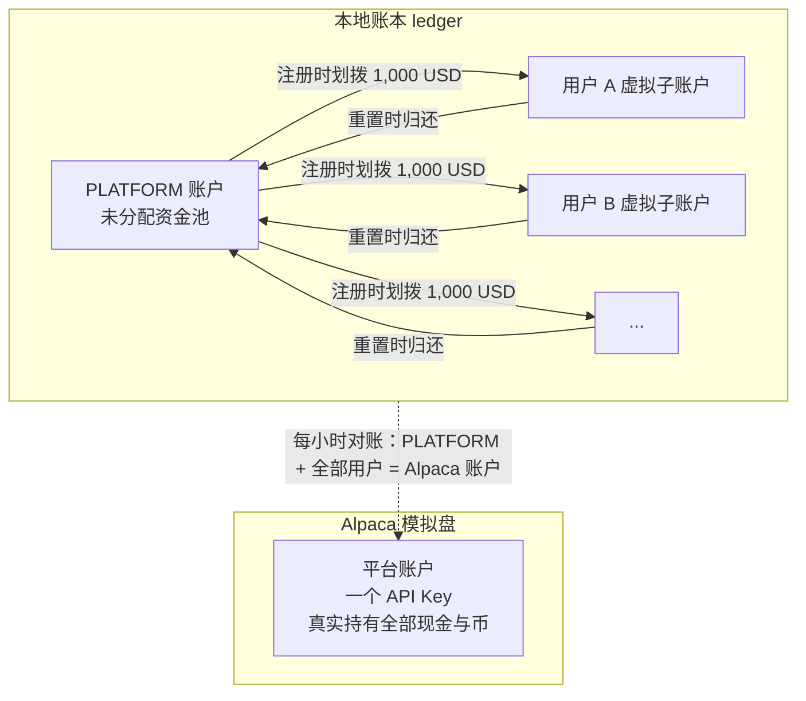
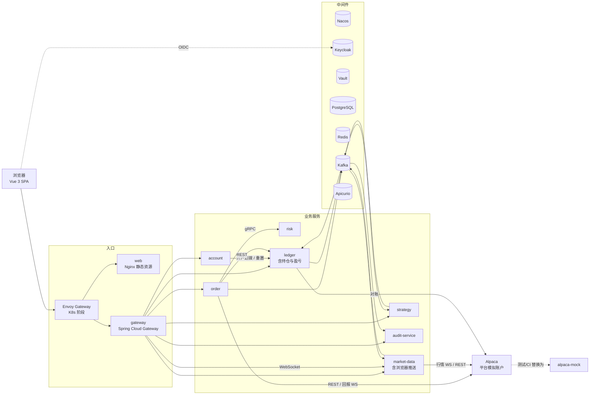
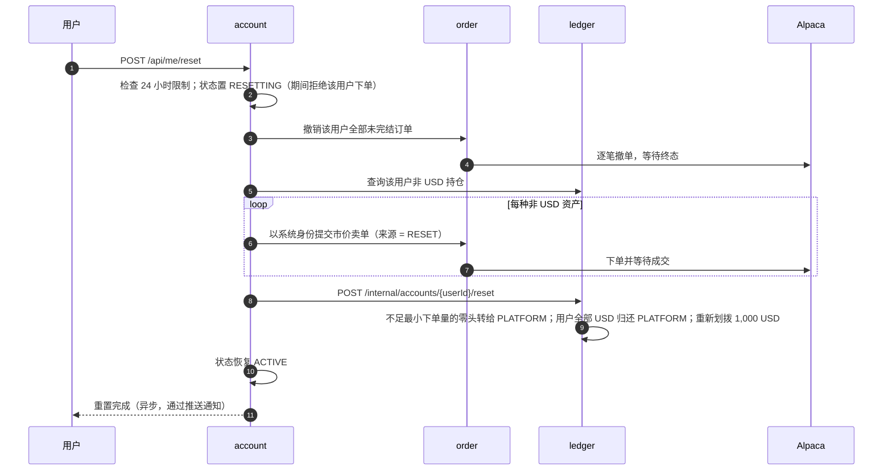
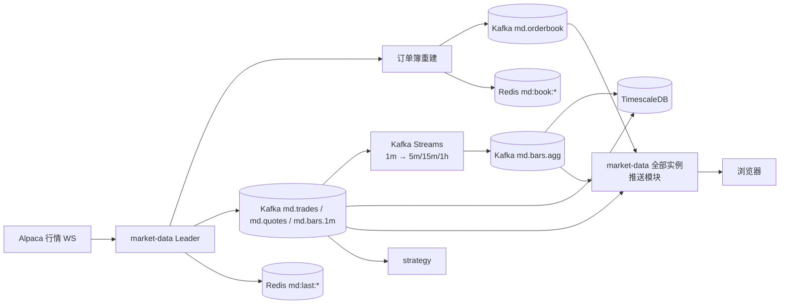
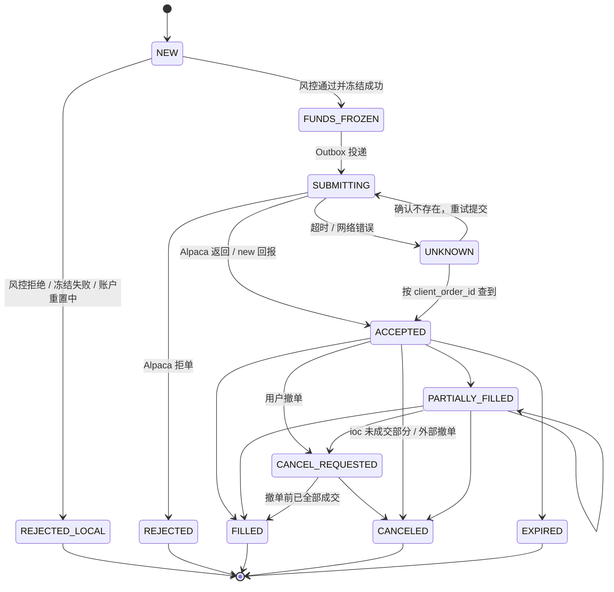
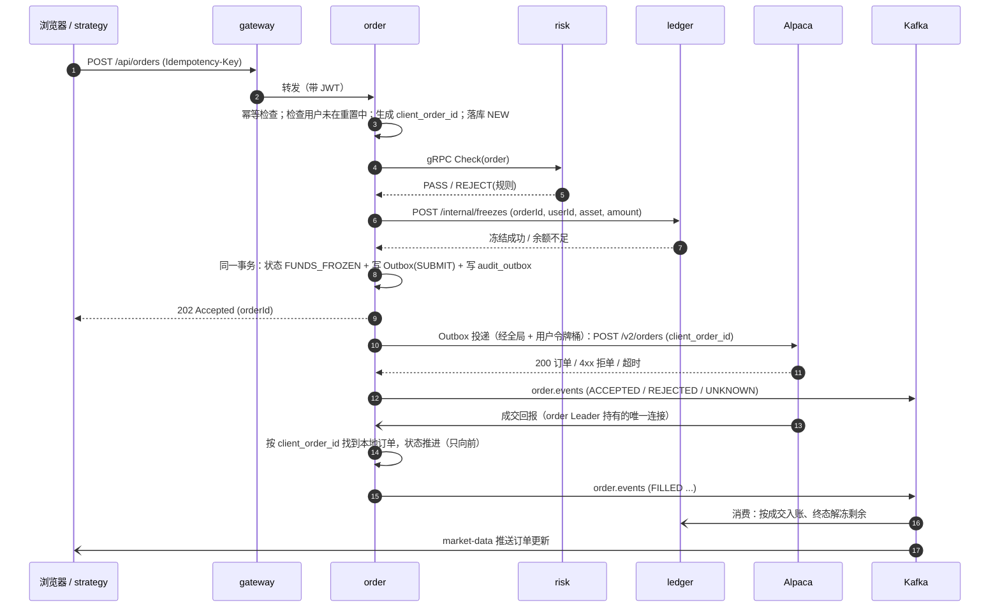
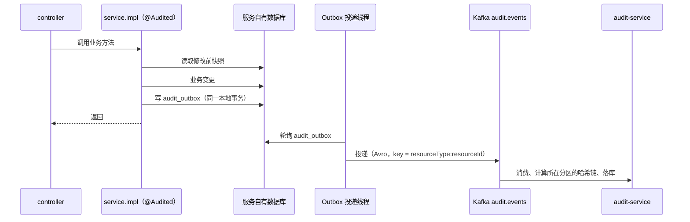
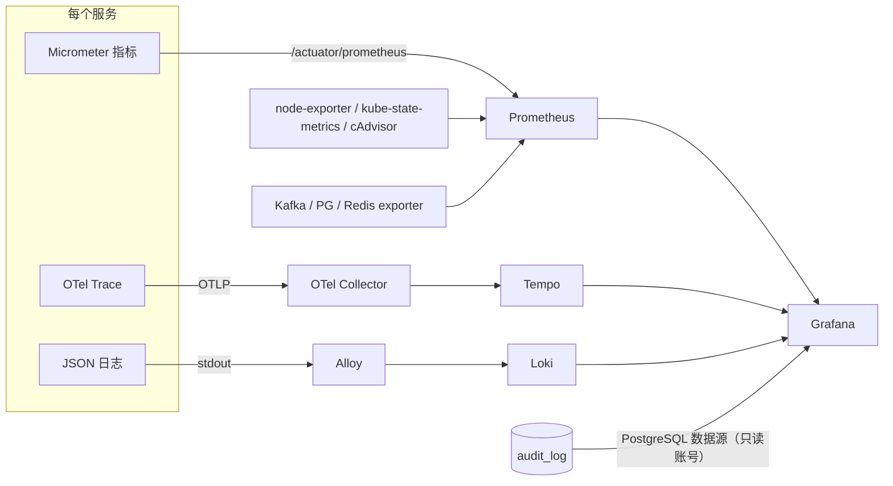

# crypto-trading 系统设计文档

本文档描述 crypto-trading 的系统设计：业务模型、服务划分、核心流程、数据与接口、安全、可观测性、部署、工程结构、前端、测试与实施路线。各组件的版本与使用场景见《crypto-trading 技术栈清单》，全部已定决策汇总在附录 A。

---

## 1. 背景与目标

crypto-trading 是一个**学习用**的微服务项目：基于 Spring Boot / Spring Cloud 搭建完整的服务体系，接入 Alpaca 的**加密货币现货模拟盘**，实现行情、下单、账本、风控、策略、审计、可观测性和云原生部署的完整闭环。

### 1.1 目标

1. 多用户：用户在平台自助注册，自动获得虚拟资金，无需注册 Alpaca。
2. 实时行情：订阅 Alpaca 加密货币行情，在浏览器中实时展示 K 线、订单簿和成交。
3. 交易：支持手动下单和策略自动下单；每笔订单真实提交到 Alpaca 模拟盘成交。
4. 账本：本地维护每个用户的多币种复式账本，平台总额定期与 Alpaca 对账。
5. 工程：覆盖服务治理、数据与缓存、分布式协同、自动扩缩容、统一可视化、审计、安全、文档、测试和 DevOps 全链路。

### 1.2 非目标

- 不做实盘交易，系统层面禁止连接 live 环境。
- 不做合约、杠杆、做空；只做现货，订单只有市价和限价。
- 不做用户之间的内部撮合，所有订单都到 Alpaca 成交。
- 不追求策略收益，策略只用于驱动系统负载。
- 不做供应链安全（依赖 / 镜像扫描、SBOM、镜像签名）。
- 不使用云托管服务（如 EKS、RDS、MSK）。主环境是本地 k3d；必要时在一台 EC2 上以与本地完全相同的 k3d 方式运行（第 10.6 节）。
- 第一版不做回测服务和通知服务。

---

## 2. 外部约束与关键假设

### 2.1 Alpaca 加密货币现货规则（来自官方文档）

| 规则 | 内容 | 对设计的影响 |
| --- | --- | --- |
| 订单类型 | market、limit、stop_limit | 本项目只用 market、limit |
| 有效期 | `gtc`、`ioc` | 下单接口只接受这两个值 |
| 下单方式 | 按 `qty`（数量）或 `notional`（金额），每个币种精度不同，如 BTC/USD 最小 0.0001 | 全程 `BigDecimal`；精度规则从资产元数据读取并缓存 |
| 保证金 / 做空 | 不支持 | 账本只有"可用 / 冻结"两种余额状态 |
| 单笔上限 | 每笔订单金额不超过 20 万美元 | 风控硬规则（用户资金远小于此值，实际不会触发） |
| 手续费 | 按 30 天交易量分档（第一档挂单 15bp / 吃单 25bp），以**收到的资产**扣除，日终入账，可通过 Activities API 查询；文档未说明模拟盘是否收费 | 用户手续费先估后调（5.4.5） |
| 交易时间 | 7×24 小时 | 无停机窗口，必须支持零停机发布 |
| 交易对格式 | `BTC/USD`（带斜杠） | URL 路径中改写为 `BTC-USD` |
| 行情 | WebSocket `v1beta3/crypto/us` 提供成交、报价、订单簿、分钟 K 线、日 K 线；免费档有额度限制 | 单连接 + 内部扇出；默认订阅 5 个交易对 |

### 2.2 关键假设（待验证，见第 15 节）

- A1：同一 API Key 的行情 WebSocket 同时只允许一条连接 → 行情连接由 market-data 的 Leader 持有。
- A2：同一账户的成交回报流同时只保持一条连接 → 由 order 的 Leader 持有。
- A3：REST 限流按 API Key 计算，约 200 次 / 分钟，所有用户共享。
- A4：Spring Cloud Alibaba 2025.1.0.0 在 Boot 4.1 + Spring Cloud 2025.1.x 最新版上可正常工作。
- A5：Alpaca 模拟账户初始权益约 10 万美元，按每人 1,000 USD 约可容纳 100 个用户。

---

## 3. 总体架构

### 3.1 账户模型



- 本地账本中有一个特殊账户 `PLATFORM`（userId = 0），代表 Alpaca 账户中尚未分配给任何用户的资金。
- 给用户发放资金 = 从 `PLATFORM` 转账给用户（一笔复式分录）。`PLATFORM` 余额不足时拒绝发放，**所有用户虚拟资金总额因此天然不超过 Alpaca 账户权益**。
- 每笔用户订单在 Alpaca 上对应一笔真实订单，成交按 `client_order_id` 归属到该用户。
- **对账恒等式：** 对每种资产，`PLATFORM 余额 + 所有用户（可用 + 冻结）= Alpaca 账户该资产余额`。

### 3.2 架构图



所有业务服务都向 Kafka 的 `audit.events` 写审计事件（图中省略连线），并统一接入可观测性平台（第 9 节）。平台的 Alpaca Key 存放在 Vault，只有 order、market-data、ledger 能读取。

### 3.3 服务清单

| 服务 | 职责 | 自有存储 | 对外接口 | 主要依赖 |
| --- | --- | --- | --- | --- |
| gateway | 路由、JWT 校验后透传令牌、按用户限流、WebSocket 转发、聚合 API 文档 | Redis（限流） | HTTPS | Nacos、Keycloak |
| account | 用户资料与偏好；首次登录开户（调用 ledger 划拨资金）；自助重置编排；管理员修改业务配置 | PG `account` | REST | ledger、order、Nacos |
| market-data | **行情接入**：Leader 持有 Alpaca 行情 WebSocket、订单簿重建、K 线落库与聚合、历史回填、资产元数据缓存；**浏览器推送**：所有实例管理浏览器 WebSocket 连接，合并推送行情与用户通知 | PG `market`（TimescaleDB）、Redis | REST、WebSocket | Kafka、Alpaca |
| order | 订单受理、Saga 编排、提交 Alpaca；Leader 持有成交回报连接；订单查询 | PG `order` | REST | risk、ledger、Alpaca、Kafka |
| risk | 下单前风控校验 | Redis（计数器） | gRPC | Nacos（规则参数）、ledger（持仓读模型） |
| ledger | **账本**：PLATFORM 与用户的多币种余额、划拨、冻结 / 解冻、复式分录、平台总额对账；**读模型**：持仓、成本、盈亏、净值曲线 | PG `ledger`、Redis | REST、Kafka 事件 | Alpaca（对账）、Kafka |
| strategy | 策略定义与实例管理；消费行情、产出交易信号并自动下单 | PG `strategy`、Redis（状态快照） | REST | Kafka、order |
| audit-service | 汇总审计事件，只追加存储，按分区哈希链防篡改，提供审计查询 | PG `audit` | REST | Kafka |
| alpaca-mock | 测试和 CI 用的模拟 Alpaca：REST、两类 WebSocket、简易撮合、行情回放、故障注入 | 内存 | 与 Alpaca 同构 | — |
| web | 前端静态资源 | — | HTTPS | gateway、Keycloak |

### 3.4 服务间通信原则

| 场景 | 方式 | 原因 |
| --- | --- | --- |
| 下单前风控 | gRPC（order → risk） | 热路径，低延迟，强类型契约 |
| 冻结 / 解冻、开户划拨、重置 | 同步 REST，HTTP Interface + LoadBalancer | 需要立即得到结果 |
| 行情分发、订单事件、账本事件、审计事件 | Kafka（Avro） | 一对多、解耦、可重放 |
| 用户实时通知 | Kafka → market-data（推送模块）→ 浏览器 | 与业务服务解耦 |
| 查询类 | REST | 简单 |

---

## 4. 技术基线（摘要）

完整清单见技术栈文档，这里只列骨架。

- **语言与构建：** JDK 25（Temurin）；Gradle 9.x（≥9.1），Groovy DSL，`build-logic` 约定插件 + `platform` 版本平台。
- **框架：** Spring Boot 4.1.x、Spring Cloud 2025.1.x、Spring Cloud Alibaba 2025.1.0.0。
- **治理：** Nacos 3.x（注册 + 配置）、Spring Cloud Gateway、LoadBalancer、HTTP Interface、Spring gRPC、Resilience4j。
- **数据：** PostgreSQL 18 + TimescaleDB、MyBatis + MyBatis-Plus、Flyway、Redis 8、Redisson、ShedLock。
- **消息：** Kafka 4.x（KRaft）、Kafka Streams、Avro + Apicurio Registry 3.x。
- **协同：** Spring Integration Leader 选举（JDBC 锁）、Outbox + Saga（自研）。
- **安全：** Keycloak 26.x、Spring Security 7 Resource Server、Vault。
- **可观测性：** Micrometer + OpenTelemetry → OTel Collector → Prometheus / Tempo / Loki，Grafana 统一可视化，Arthas。
- **交付：** Jib、Docker Compose、k3d、Helm、Argo CD、Argo Rollouts、Envoy Gateway。
- **弹性伸缩：** Kubernetes HPA + metrics-server + KEDA。
- **审计：** 自研 `common-audit` 库 + audit-service。
- **前端：** Vue 3.5、Vite 8、Pinia、TanStack Query、Tailwind CSS 4 + shadcn-vue、Lightweight Charts、ECharts、vue-i18n。

---

## 5. 核心设计

### 5.1 用户开户与重置

#### 5.1.1 开户

1. 用户在 Keycloak 登录页自助注册（默认角色 `user`）。
2. 前端登录后首先调用 `GET /api/me`。account 发现该用户（JWT `sub`）尚无档案时，**幂等地**创建档案，并调用 ledger `POST /internal/accounts/{userId}/provision`。
3. ledger 在一个事务中：创建用户各资产余额行，从 `PLATFORM` 划拨 1,000 USD（金额配置在 Nacos `ledger.yaml`）。
4. `PLATFORM` 的 USD 不足时：用户档案照常创建、余额为 0，返回英文状态码 `fundingStatus = INSUFFICIENT_PLATFORM_FUNDS`（前端按状态码显示"平台资金不足，请联系管理员"或对应英文，见 12.4），并触发告警。管理员可在后台补发（`POST /api/admin/users/{id}/funds`）。
5. 全过程记审计：`ACCOUNT_PROVISION`（成功或失败）。

#### 5.1.2 自助重置

用户每 24 小时可重置一次，恢复为 1,000 USD 初始状态：



- 重置是一个由 account 编排的 Saga，状态持久化在 `account_reset` 表，任一步失败可从断点继续（定时任务扫描卡住超过 5 分钟的重置）。
- 卖出产生的成交与普通订单走同一条入账链路；零头转移和资金归还在 ledger 中都是复式分录。
- 审计：`ACCOUNT_RESET`（含重置前各资产余额快照）。

### 5.2 行情链路

#### 5.2.1 数据流



#### 5.2.2 Leader 选举与故障切换

- 所有 market-data 实例都启动，通过 `LockRegistryLeaderInitiator` + `JdbcLockRegistry` 竞争 Leader。只有 Leader 建立 Alpaca 行情连接；所有实例都提供查询接口和浏览器推送。
- **Fencing Token：** 每次当选时从数据库序列取一个递增的 `epoch`，写入所有发出的 Kafka 消息头 `x-leader-epoch`。下游发现 epoch 回退的消息直接丢弃，防止旧 Leader 失去锁后仍短暂写入。
- **缺口回填：** 新 Leader 当选后，读取 Redis `md:bars:last-ts:{symbol}`，用 REST 拉取缺失的分钟 K 线补发到 `md.bars.1m`，消息头标记 `x-backfill=true`。
- K8s 阶段增加对照实现：Spring Cloud Kubernetes Leader 选举（Lease 对象）。

#### 5.2.3 WebSocket 客户端

- 连接 → `auth` → `subscribe`（交易对列表来自 Nacos `market-data.yaml`，默认 BTC/USD、ETH/USD、SOL/USD、LTC/USD、DOGE/USD，以 Alpaca 实际可交易列表为准）。
- 心跳：30 秒无消息视为假死，主动重连。
- 重连：指数退避 1s、2s、4s…，上限 60s，±20% 抖动；成功后重新认证、重新订阅，并全量重建订单簿。
- 订阅列表变更时只发送差量 `subscribe` / `unsubscribe`，不断线。

#### 5.2.4 订单簿重建

- 每个交易对两棵 `TreeMap<BigDecimal, BigDecimal>`（bids 降序、asks 升序）。
- 收到快照：整体替换。收到增量：逐价位更新，数量为 0 时删除该价位。
- 每 200ms 把前 20 档写入 Redis 并发布到 `md.orderbook`（合并发布）。
- **校验任务（ShedLock，每 5 分钟）：** 用 REST 拉取最新订单簿，与本地前 10 档比较，差异超阈值则计数并强制重建。

#### 5.2.5 浏览器推送（market-data 推送模块）

- 每个实例都以独立消费组消费行情 Topic，按 `symbol` 维护最新值。
- **合并推送：** 每个连接每个交易对每 250ms 最多推一次（只推最新值），订单簿每 500ms 一次。
- 用户私有通知（订单、余额变化）：消费 `order.events`、`ledger.events`，通过 Redis Pub/Sub `push:user:{userId}` 投递到持有该用户连接的实例。
- 推送模块与行情接入模块在代码上分属不同目录（`stream/` 与 `push/`），便于将来再拆成独立服务。

### 5.3 订单生命周期

#### 5.3.1 本地订单状态机



- 订单类型只有 `MARKET`、`LIMIT`；有效期只有 `GTC`、`IOC`。
- 状态用枚举 + 转换表建模（`statemachine/` 目录），参数化测试覆盖全部合法 / 非法转换。
- **状态只能向前推进：** 每个状态有序号 `rank`，更新语句带 `WHERE version=? AND rank(当前) < rank(目标)`，旧的、重复的回报自然被忽略。
- `filled_qty` 以 Alpaca 回报中的**累计**成交量为准（取最大值），天然抗重复。
- 订单来源 `source`：`MANUAL` / `STRATEGY` / `RESET`。

#### 5.3.2 下单时序（Saga）



#### 5.3.3 幂等

| 层 | 机制 |
| --- | --- |
| 客户端 → order | 请求头 `Idempotency-Key`（UUID），表 `order_idempotency(user_id, key)` 唯一索引，重复请求返回首次结果 |
| strategy → order | 信号 ID 作为 `Idempotency-Key` |
| order → Alpaca | 本地生成 `client_order_id = "ct-" + orderId`，落库后才提交；重试始终使用同一个 ID |
| Kafka 消费 | 消费端表 `consumed_event(consumer, event_id)` 唯一索引，在业务事务内插入 |

#### 5.3.4 UNKNOWN 处理

1. 提交超时或连接异常 → 状态置 `UNKNOWN`，**不直接重试**。
2. 补偿任务（ShedLock，每 10 秒）扫描 `UNKNOWN` 超过 5 秒的订单，按 `client_order_id` 查询 Alpaca：查到则按返回状态推进；明确不存在（404）则回到 `SUBMITTING` 用同一 ID 重新提交；仍超时则下次再查。
3. `UNKNOWN` 超过 5 分钟触发告警。状态变更记审计 `ORDER_RECOVER`。

#### 5.3.5 成交回报连接

- 平台只有一个 Alpaca 账户，因此只有一条成交回报连接，由 order 服务的 **Leader** 持有（与 market-data 相同的 JDBC 锁 Leader 选举机制，锁名不同）。
- Leader 收到回报后，按 `client_order_id`（前缀 `ct-`）找到本地订单；非本平台前缀的回报记录告警日志后丢弃。
- Leader 切换期间可能漏掉的回报，由**未完结订单轮询任务**兜底：每 30 秒查询所有 `ACCEPTED` / `PARTIALLY_FILLED` / `CANCEL_REQUESTED` 订单在 Alpaca 的最新状态（受全局令牌桶约束，只取"最近 1 分钟内未收到回报"的订单）。
- 非 Leader 实例照常处理 REST 下单、撤单和查询，所以 order 可以横向扩容。

#### 5.3.6 撤单

- `DELETE /api/orders/{id}` → 状态置 `CANCEL_REQUESTED` → 调用 Alpaca 撤单接口；最终状态以回报为准（可能是 `CANCELED`，也可能已 `FILLED`）。

### 5.4 账本（ledger）

#### 5.4.1 数据模型

```sql
-- 余额：每个账户（含 PLATFORM，user_id = 0）每资产一行
account_balance(
  user_id    BIGINT,
  asset      VARCHAR(16),        -- USD / BTC / ETH / SOL / LTC / DOGE
  available  NUMERIC(38,18),
  frozen     NUMERIC(38,18),
  version    BIGINT,
  created_at, created_by, updated_at, updated_by,
  PRIMARY KEY (user_id, asset),
  CHECK (available >= 0 AND frozen >= 0)
);

-- 冻结单：每个订单一条
freeze(id, user_id, order_id UNIQUE, asset, amount, consumed, released, status, ...);

-- 分录：只追加，永不修改
ledger_entry(
  id, tx_id, user_id, asset,
  account_type,   -- AVAILABLE / FROZEN / EXTERNAL / FEE
  amount NUMERIC(38,18),          -- 借正贷负
  entry_type,     -- ALLOCATE / RECLAIM / FREEZE / UNFREEZE / TRADE / FEE / FEE_ADJUST / DUST / RECONCILE
  ref_type, ref_id, created_at, created_by
);

reconcile_diff(id, asset, local_total, remote_total, diff, detected_at, status, ...);
```

- **不变式 1：** 同一 `tx_id` 的所有分录之和为 0。
- **不变式 2：** `available`、`frozen` 永不为负（CHECK 约束 + 条件更新）。
- **不变式 3：** 每个账户每资产，`available + frozen` 等于其分录中 AVAILABLE 与 FROZEN 两类之和。
- **不变式 4（对账恒等式）：** 每资产，`Σ 所有账户（含 PLATFORM）的 available + frozen` = Alpaca 账户该资产余额（容差内）。
- 不变式 1–3 用 jqwik 属性测试验证，并由每日巡检任务检查；不变式 4 由对账任务检查。

#### 5.4.2 资金划拨

| 操作 | 分录 |
| --- | --- |
| 开户 / 管理员补发（ALLOCATE） | PLATFORM.USD.AVAILABLE −X，用户.USD.AVAILABLE +X |
| 重置归还（RECLAIM） | 用户各资产.AVAILABLE −全部，PLATFORM 对应资产 +全部 |
| 零头转移（DUST） | 用户某币.AVAILABLE −零头，PLATFORM 该币 +零头 |

`PLATFORM` 的余额同样受 CHECK 约束，不足时划拨失败。

#### 5.4.3 冻结规则

| 订单 | 冻结资产 | 冻结金额 |
| --- | --- | --- |
| 限价买 | 报价货币 | `qty × limit_price × (1 + 最高费率)` |
| 市价买（按 notional，定投使用） | 报价货币 | `notional × (1 + 最高费率)` |
| 市价买（按 qty） | 报价货币 | `qty × 最新卖一价 × (1 + 滑点缓冲) × (1 + 最高费率)` |
| 任意卖单 | 基础货币 | `qty` |

最高费率默认 25bp、滑点缓冲默认 1%，均配置在 Nacos `ledger.yaml`。

#### 5.4.4 成交与解冻

- 消费 `order.events` 的成交事件（本次成交量、成交价）：
  - 买单：用户冻结的报价货币减少 `成交量 × 成交价`；基础货币可用增加 `成交量`。
  - 卖单：冻结的基础货币减少 `成交量`；报价货币可用增加 `成交量 × 成交价`。
- 订单终态时剩余冻结全部解冻。
- 每次变更：条件更新余额 + 写分录 + 写 Outbox（`ledger.events`），在一个本地事务中完成。

#### 5.4.5 手续费

Alpaca 的手续费按平台账户整体交易量分档、日终入账，且模拟盘是否收费未确认，采用"**先估后调**"：

1. 成交时按当前费率估算用户手续费，记 `FEE` 分录（从收到的资产中扣除，与 Alpaca 规则一致），费用计入 PLATFORM 的 FEE 账户。
2. 每日对账任务拉取 Activities 中的手续费流水，能按订单匹配的，差额记该用户的 `FEE_ADJUST`；无法匹配的差额记入 PLATFORM。
3. 若确认模拟盘不收费，把估算费率配置为 0 即可。

#### 5.4.6 平台总额对账

- 每小时（ShedLock）：拉取 Alpaca 账户现金与全部持仓，对每种资产检查不变式 4。
- 差异超过容差写入 `reconcile_diff` 并告警，**不自动修正**；管理员确认后通过 `POST /api/admin/reconcile-diffs/{id}/confirm` 调整 PLATFORM 余额（`RECONCILE` 分录，必须填写原因，记审计）。
- 系统首次启动时，以 Alpaca 账户当前现金和持仓初始化 PLATFORM 余额（`BALANCE_INIT`，记审计）。

#### 5.4.7 持仓与盈亏读模型

- 在 ledger 内部按 CQRS 方式维护，与账本写模型分属不同目录和不同表（`position`、`pnl_daily`、`equity_snapshot`）。
- 由 ledger 消费自己发出的 `ledger.events` 更新（与写入解耦，允许短暂延迟），估值使用 Redis `md:last:{symbol}`。
- 持仓成本采用移动加权平均；每小时记录一次净值快照，用于净值曲线。
- 风控 R06 / R07 读取该读模型在 Redis 中的缓存 `pf:summary:{userId}`。

### 5.5 风控（risk）

```protobuf
service RiskService {
  rpc Check(CheckRequest) returns (CheckResponse);
}
message CheckRequest {
  int64 user_id = 1;
  string symbol = 2;              // BTC/USD
  Side side = 3;                  // BUY / SELL
  OrderType type = 4;             // MARKET / LIMIT
  string qty = 5;                 // 十进制字符串
  string notional = 6;
  string limit_price = 7;
  TimeInForce tif = 8;            // GTC / IOC
  OrderSource source = 9;         // MANUAL / STRATEGY / RESET
}
message CheckResponse {
  bool passed = 1;
  string rule = 2;                // R01–R07；前端按规则编码显示中英文原因
  string message = 3;             // 英文说明，只用于日志和排查
}
```

| 编码 | 规则 | 默认值（Nacos `risk.yaml`） |
| --- | --- | --- |
| R01 | 交易对存在且可交易 | — |
| R02 | 数量 / 价格 / 金额符合精度和最小下单量 | — |
| R03 | 单笔金额 ≤ 20 万美元（Alpaca 上限） | — |
| R04 | 限价单价格偏离最新价不超过阈值 | ±10% |
| R05 | 单用户每分钟下单次数上限 | 30 次 |
| R06 | 当日已实现亏损上限（占初始资金比例） | 50% |
| R07 | 单币种持仓占总资产比例上限（买单） | 80% |

- `source = RESET` 的订单只执行 R01–R03。
- 余额是否足够**不在 risk 校验**，由 ledger 冻结时原子判断，避免检查与扣减之间的竞态。
- 规则参数变更只能通过管理接口修改（5.10），生效时 risk 记审计 `RISK_RULE_APPLIED`。

### 5.6 Alpaca 调用限流

所有用户共用平台的一个 Key，采用两级令牌桶（Redis + Lua 原子扣减，所有实例共享）：

| 桶 | Key | 默认容量 | 说明 |
| --- | --- | --- | --- |
| 全局桶 | `alpaca:rl:global` | 180 次 / 分钟 | 按 A3 假设留 10% 余量 |
| 用户桶 | `alpaca:rl:user:{userId}` | 20 次 / 分钟 | 只约束用户订单的下单和撤单 |

- 用户订单先扣用户桶、再扣全局桶；任一不足则该订单在 Outbox 中延迟投递（不丢弃），用户桶长期不足时风控 R05 先行拒绝。
- **全局桶优先级预留：** 下单 / 撤单可用全部令牌；系统查询（UNKNOWN 恢复、未完结订单轮询）在剩余低于 30% 时暂停；对账与历史回填在低于 50% 时暂停。
- 重置流程中的系统卖单不扣用户桶，只扣全局桶。
- 收到 429：Resilience4j 指数退避重试（仅限查询和带 `client_order_id` 的下单），同时清空全局桶 10 秒。
- 参数均在 Nacos `order.yaml`。

### 5.7 策略引擎（strategy）

#### 5.7.1 内置策略

| 策略 | 参数 | 行为 | 订单 |
| --- | --- | --- | --- |
| 均线交叉 | 交易对、K 线周期、快线 / 慢线周期、每次金额 | 快线上穿慢线买入，下穿卖出全部 | 市价 |
| 网格 | 交易对、价格上下限、格数、每格数量 | 在区间内等距挂买卖限价单，成交一格挂反向单 | 限价 GTC |
| 定投（DCA） | 交易对、间隔（1 小时 / 1 天 / 1 周）、每次金额（不低于交易对最小下单额） | 到点按金额市价买入 | 市价（按 notional） |

#### 5.7.2 运行机制

- **模型：** 策略定义（类型 + 参数 JSON Schema）→ 策略实例（用户 × 交易对 × 参数 × 状态：运行 / 暂停）。每个用户最多同时运行 5 个实例。
- **执行：** 每个运行中的实例一个虚拟线程。均线交叉和网格由 K 线 / 成交事件驱动；定投由时间驱动（实例内记录下次执行时间，到点触发）。
- **分片：** 实例按 `strategyInstanceId` 用 Rendezvous Hashing（HRW）分配到 strategy 服务实例。每个服务实例在 Redis 注册租约 `strategy:instances:{id}`（TTL 15 秒），每 5 秒重新计算自己负责的集合。扩缩容时只有少量策略实例迁移。
- **状态与故障转移：** 每处理一次事件后把状态写入 Redis `strategy:state:{id}`。接管时加载快照，通过 market-data 的历史 K 线接口补读快照之后的 K 线（strategy 不直接访问 market schema），再切换到实时流；定投若错过执行时间，只补执行一次。
- **信号与下单：** 信号 ID 确定性生成（`实例ID + 触发时间 + 动作`），写入 `strategy.signals` 后由下单执行器自动调用 order（信号 ID 作为幂等键），重复信号不会重复下单。
- 用户账户重置时，其所有策略实例自动暂停（记审计）。

### 5.8 alpaca-mock

| 能力 | 实现 |
| --- | --- |
| REST | WireMock（账户、持仓、资产、下单、撤单、查询、Activities），支持有状态场景 |
| 行情 WebSocket | 自研小服务：从录制文件回放（原速 / 倍速），协议与 Alpaca 一致 |
| 成交回报 WebSocket | 自研：订单被模拟撮合后推送 new / partial_fill / fill / canceled |
| 撮合 | 用回放的订单簿判断限价单是否可成交，市价单吃对手盘，支持部分成交 |
| 故障注入 | 管理接口：返回 429、延迟、断开 WebSocket、丢弃 / 重复 / 乱序回报 |
| 录制 | market-data 的一个开关：把真实行情原样写入文件 |

所有集成测试和 CI 都连 alpaca-mock；只有手动联调连真实模拟盘。

### 5.9 审计日志

#### 5.9.1 审计范围

以下操作**必须**记录审计日志，成功、失败、权限不足被拒绝都要记：

| 服务 | 操作 | 动作编码 |
| --- | --- | --- |
| account | 开户（含资金划拨结果） | `ACCOUNT_PROVISION` |
| account | 自助重置（含重置前余额快照） | `ACCOUNT_RESET` |
| account | 修改用户资料、偏好 | `PROFILE_UPDATE` |
| account | 管理员修改 Nacos 业务配置（含修改前后差异） | `CONFIG_UPDATE` |
| order | 下单、撤单（含来源） | `ORDER_CREATE` / `ORDER_CANCEL` |
| order | 补偿任务改变 UNKNOWN 订单状态 | `ORDER_RECOVER` |
| ledger | 划拨、归还、零头转移 | `FUNDS_ALLOCATE` / `FUNDS_RECLAIM` / `FUNDS_DUST` |
| ledger | 冻结 / 解冻（含 Saga 补偿） | `FUNDS_FREEZE` / `FUNDS_RELEASE` |
| ledger | 初始化 PLATFORM 余额、人工确认对账差异、手续费调整 | `BALANCE_INIT` / `BALANCE_ADJUST` / `FEE_ADJUST` |
| strategy | 创建、修改参数、启动、停止、删除、因重置自动暂停 | `STRATEGY_*` |
| risk | 风控规则参数生效 | `RISK_RULE_APPLIED` |
| audit-service | 管理员查询审计日志 | `AUDIT_QUERY` |
| Keycloak | 注册、登录、登出、登录失败、角色变更 | Keycloak 自带的用户事件与管理事件，经 Alloy 送入 Loki，在 Grafana 审计大盘中与业务审计并列展示 |

成交入账这类高频、由 Alpaca 回报驱动的变更不逐条写审计，它们已有不可修改的 `ledger_entry` 和 `order_fill` 记录。

#### 5.9.2 审计记录结构

```text
AuditEvent {
  eventId       UUID
  occurredAt    时间（UTC）
  service       产生服务
  action        动作编码
  resourceType  资源类型
  resourceId    资源 ID
  actorType     USER / ADMIN / SYSTEM
  actorId       Keycloak sub，或系统任务名（如 system:ledger-reconcile）
  onBehalfOf    代谁操作：策略下单、重置卖单时为对应用户
  clientIp      gateway 透传的客户端 IP
  userAgent     浏览器标识
  traceId       链路 ID，可跳转 Tempo
  result        SUCCESS / FAILURE / DENIED
  errorCode     失败时的错误码
  before        修改前快照（JSON，已脱敏）
  after         修改后快照（JSON，已脱敏）
  reason        备注（管理员调账、补发资金时必填）
}
```

脱敏规则：任何密钥、令牌、密文字段一律不记录；金额、数量照常记录。

#### 5.9.3 写入方式：与业务变更同一事务



- `libs/common-audit` 提供 `@Audited` 注解与切面，只能用在 `service.impl` 中（ArchUnit 约束）。
- **审计与业务同生同死：** 业务回滚，审计不落库；审计写入失败，业务也回滚。
- 失败和被拒绝的操作在单独的 `REQUIRES_NEW` 事务中记录。
- 系统任务通过 `AuditContext.runAsSystem("system:xxx", ...)` 声明执行者。
- 修改前快照由各服务实现 `AuditSnapshotProvider` 接口提供。

#### 5.9.4 存储、防篡改与扩容

- `audit.events` 有 6 个分区，以 `resourceType:resourceId` 为 key，同一资源的审计事件有序。
- **每个分区一条独立哈希链。** 表 `audit_chain_head(partition, last_seq, last_hash)` 记录每条链的末尾。audit-service 写入时在同一事务中：`SELECT ... FOR UPDATE` 锁住该分区的链头 → 计算 `hash = SHA-256(last_hash + 记录内容)` → 插入 `audit_log(partition, seq, prev_hash, hash, ...)` → 更新链头。`(partition, seq)` 唯一约束保证扩缩容再平衡期间即使两个实例短暂处理同一分区，也不会产生分叉。
- audit-service 可扩容到分区数（6 个副本）；消费端以 `eventId` 去重。
- **只追加：** audit-service 的数据库账号只有 `INSERT`、`SELECT` 权限（链头表另授 `UPDATE`）；`audit_log` 上的触发器拒绝任何 `UPDATE` / `DELETE`。
- 表按月分区，保留 1 年；过期分区由运维迁移脚本归档后删除。
- 每日任务逐分区校验哈希链，断裂立即告警。

#### 5.9.5 查询

- `GET /api/admin/audit-logs`：仅 `admin`，支持按操作人、动作、资源、时间筛选；查询本身记 `AUDIT_QUERY`。
- `GET /api/me/activity`：普通用户查看 `actorId` 或 `onBehalfOf` 为本人的记录。
- 前端：管理员页面 `/admin/audit`；用户在设置页查看"我的操作记录"。

### 5.10 配置管理（Nacos）

| 命名空间 | 用途 |
| --- | --- |
| `dev` | Docker Compose 环境 |
| `k8s` | k3d 集群环境（本地与 EC2 各自一套 Nacos，使用相同命名空间） |

| Data ID | 内容 | 动态刷新 |
| --- | --- | --- |
| `common.yaml` | Kafka、Redis、OTel 地址 | 否 |
| `market-data.yaml` | 订阅交易对、订单簿档数、推送频率 | 是 |
| `risk.yaml` | 风控阈值 R04–R07 | 是 |
| `order.yaml` | 超时、重试、全局与用户令牌桶参数 | 是 |
| `ledger.yaml` | 开户金额、估算费率、滑点缓冲、对账容差与周期 | 是 |
| `account.yaml` | 重置间隔（24 小时） | 是 |
| `strategy.yaml` | 每用户最多运行中策略实例数（5）、定投可选间隔 | 是 |

- **修改入口：** 业务配置只能通过管理接口 `PUT /api/admin/configs/{dataId}` 修改（必须填写原因），由 account 调用 Nacos OpenAPI 写入并记审计 `CONFIG_UPDATE`。Nacos 控制台写权限只保留给运维账号作应急；Nacos 自带配置历史作为第二份记录。
- 敏感信息（数据库密码、平台 Alpaca Key、Keycloak client secret）不放 Nacos，由 Vault 提供。

---

## 6. 数据设计

### 6.1 数据库

- 一个 PostgreSQL 实例，每个服务一个独立 schema 和独立数据库用户，**禁止跨 schema 访问**。
- 表结构全部由 Flyway 管理，MyBatis-Plus 不自动建表。
- 金额 `NUMERIC(38,18)`；时间 `TIMESTAMPTZ`（UTC）。
- 每个写库服务都有 `outbox`、`audit_outbox`、`consumed_event` 表。
- 所有业务表都有 `created_at`、`created_by`、`updated_at`、`updated_by`，由 MyBatis-Plus 自动填充。

| schema | 主要表 |
| --- | --- |
| account | `user_profile`、`user_preference`、`account_reset`、`outbox`、`audit_outbox`、`shedlock` |
| market | `bar_1m`（超表）、`bar_agg`（连续聚合）、`asset_meta`、`INT_LOCK`、`leader_epoch`、`shedlock` |
| order | `orders`、`order_fill`、`order_idempotency`、`INT_LOCK`、`leader_epoch`、`outbox`、`audit_outbox`、`consumed_event`、`shedlock` |
| ledger | 写模型：`account_balance`、`freeze`、`ledger_entry`、`reconcile_diff`；读模型：`position`、`pnl_daily`、`equity_snapshot`；`outbox`、`audit_outbox`、`consumed_event`、`shedlock` |
| strategy | `strategy_def`、`strategy_instance`、`signal`、`outbox`、`audit_outbox`、`consumed_event` |
| audit | `audit_log`（按月分区，只追加）、`audit_chain_head`、`audit_chain_check` |

### 6.2 Kafka Topic

| Topic | Key | 分区 | 保留 | 生产者 | 消费者 |
| --- | --- | --- | --- | --- | --- |
| `md.trades` | symbol | 6 | 1 天 | market-data | market-data 推送、strategy |
| `md.quotes` | symbol | 6 | 1 天 | market-data | market-data 推送 |
| `md.orderbook` | symbol | 6 | 1 小时 | market-data | market-data 推送 |
| `md.bars.1m` | symbol | 6 | 7 天 | market-data | Kafka Streams、strategy、落库 |
| `md.bars.agg` | symbol | 6 | 7 天 | Kafka Streams | market-data 推送、落库 |
| `order.events` | userId | 6 | 7 天 | order | ledger、market-data 推送、strategy |
| `ledger.events` | userId | 6 | 7 天 | ledger | ledger 读模型、market-data 推送 |
| `strategy.signals` | strategyInstanceId | 6 | 3 天 | strategy | strategy 下单执行器 |
| `audit.events` | resourceType:resourceId | 6 | 30 天 | 全部服务 | audit-service |
| `*.DLT` | 同源 | 同源 | 14 天 | 重试失败 | 人工处理 |

- 分区数统一为 6，与消费 Kafka 的服务的最大副本数（设计值 6）一致。
- 所有事件用 Avro，Schema 在 `libs/events-schema`，Apicurio 中每个 Topic 设为 `BACKWARD` 兼容。
- 公共字段 `eventId`、`eventType`、`occurredAt`、`producer`；trace 上下文和 `x-leader-epoch` 放消息头。
- 金额字段使用 Avro `decimal` 逻辑类型（precision 38，scale 18）。

### 6.3 Redis Key

| Key | 类型 | 用途 | TTL |
| --- | --- | --- | --- |
| `md:last:{symbol}` | Hash | 最新价、24h 涨跌 | 无 |
| `md:book:{symbol}:bids` / `:asks` | ZSet | 订单簿前 N 档 | 无 |
| `md:bars:last-ts:{symbol}` | String | 最后一根 K 线时间 | 无 |
| `gw:rl:{userId}` | 令牌桶 | 网关按用户限流 | 自动 |
| `alpaca:rl:global` | Hash | Alpaca 全局令牌桶 | 自动 |
| `alpaca:rl:user:{userId}` | Hash | Alpaca 用户配额桶 | 自动 |
| `risk:cnt:{userId}:{minute}` | String | 下单频率计数 | 2 分钟 |
| `strategy:instances:{id}` | String | strategy 实例租约 | 15 秒 |
| `strategy:state:{instanceId}` | Hash | 策略状态快照 | 7 天 |
| `pf:summary:{userId}` | Hash | 持仓汇总缓存 | 10 秒 |
| `account:reset-lock:{userId}` | String | 重置 24 小时限制 | 24 小时 |
| `account:status:{userId}` | String | 重置进行中标记（`RESETTING`），order 据此拒单 | 重置结束删除 |
| `push:user:{userId}` | Pub/Sub | 用户私有通知 | — |

---

## 7. 接口设计

### 7.1 对外 REST（经 gateway，前缀 `/api`）

| 方法 | 路径 | 服务 | 说明 |
| --- | --- | --- | --- |
| GET | `/api/me` | account | 当前用户（首次调用时开户） |
| PUT | `/api/me/preferences` | account | 语言、主题、涨跌颜色 |
| POST | `/api/me/reset` | account | 自助重置（24 小时一次） |
| GET | `/api/me/activity` | audit-service | 我的操作记录 |
| GET | `/api/assets` | market-data | 可交易资产与精度规则 |
| GET | `/api/market/{symbol}/bars?tf=1m&from&to` | market-data | 历史 K 线 |
| GET | `/api/market/{symbol}/snapshot` | market-data | 最新价 + 订单簿快照 |
| POST | `/api/ws-ticket` | market-data | 获取 WebSocket 一次性票据 |
| POST | `/api/orders` | order | 下单（需 `Idempotency-Key`） |
| DELETE | `/api/orders/{id}` | order | 撤单 |
| GET | `/api/orders?status&symbol&page` | order | 订单列表 |
| GET | `/api/orders/{id}` | order | 订单详情（含成交明细） |
| GET | `/api/balances` | ledger | 各资产可用 / 冻结 |
| GET | `/api/ledger/entries?asset&page` | ledger | 资金流水 |
| GET | `/api/portfolio` | ledger | 持仓、成本、浮动盈亏 |
| GET | `/api/portfolio/equity?range=7d` | ledger | 净值曲线 |
| GET/POST/PUT/DELETE | `/api/strategies...` | strategy | 策略实例增删改、启停 |
| GET | `/api/admin/audit-logs` | audit-service | 审计查询 |
| PUT | `/api/admin/configs/{dataId}` | account | 修改业务配置（必填原因） |
| POST | `/api/admin/users/{id}/funds` | ledger | 管理员补发资金（必填原因） |
| GET | `/api/admin/platform` | ledger | PLATFORM 资金池余额、已分配总额、对账状态 |
| POST | `/api/admin/reconcile-diffs/{id}/confirm` | ledger | 确认对账差异并调账（必填原因） |

约定：交易对在路径中写作 `BTC-USD`；金额、数量用字符串；错误响应为 RFC 9457 Problem Details，其中 `code` 是稳定的英文错误码（大写下划线，例如 `INSUFFICIENT_PLATFORM_FUNDS`），`title` / `detail` 只用英文；后端不做国际化，前端按 `code` 显示中英文文案（12.4）；API 版本化使用 Spring Framework 7 内置版本化（请求头 `API-Version`）。

### 7.2 内部接口（路径前缀 `/internal`，gateway 不路由）

| 调用方 → 被调方 | 方式 | 接口 |
| --- | --- | --- |
| order → risk | gRPC | `RiskService.Check` |
| order → ledger | REST | `POST /internal/freezes`、`DELETE /internal/freezes/{orderId}` |
| account → ledger | REST | `POST /internal/accounts/{userId}/provision`、`POST /internal/accounts/{userId}/reset` |
| account → order | REST | `POST /internal/users/{userId}/cancel-all`、`POST /internal/orders`（系统卖单） |
| account → strategy | REST | `POST /internal/users/{userId}/pause-all` |

内部调用使用 Keycloak client_credentials 令牌 + mTLS，按 scope 授权。

### 7.3 浏览器 WebSocket 协议（market-data）

```jsonc
// 客户端 → 服务端
{"op": "subscribe",   "channels": ["ticker:BTC/USD", "book:BTC/USD", "bars:BTC/USD:1m"]}
{"op": "unsubscribe", "channels": ["book:BTC/USD"]}
{"op": "ping"}

// 服务端 → 客户端
{"ch": "ticker:BTC/USD", "data": {"p": "97123.5", "chg24h": "0.0123", "ts": 1763600000000}}
{"ch": "book:BTC/USD",   "data": {"bids": [["97120","0.5"]], "asks": [["97125","0.3"]], "ts": 1763600000000}}
{"ch": "user:orders",    "data": {"orderId": "...", "status": "FILLED"}}       // 登录后自动订阅
{"ch": "user:balances",  "data": {"asset": "USD", "available": "512.30"}}
{"ch": "user:notice",    "data": {"type": "RESET_DONE"}}
{"op": "pong"}
```

连接时通过查询参数携带一次性票据（`POST /api/ws-ticket` 获取，30 秒有效），不把 JWT 放在 URL 中。

---

## 8. 安全设计

### 8.1 Keycloak

| 项 | 配置 |
| --- | --- |
| Realm | `crypto-trading`，开放自助注册，不验证邮箱 |
| Client `web` | public client，授权码 + PKCE |
| Client `svc-*` | 每个需要调用内部接口的服务一个 confidential client，client_credentials |
| Client `grafana` | Grafana 单点登录，只允许 `admin` 角色 |
| Realm 角色 | `user`（注册默认）、`admin` |
| Client scope | `internal.ledger`、`internal.order`、`internal.strategy`，按需授予服务 client |
| 其他 | 访问令牌 5 分钟、刷新令牌 30 分钟；MFA（TOTP / Passkey）可选；登录失败锁定策略 |

realm 配置导出为 `deploy/keycloak/realm-crypto-trading.json`，启动时自动导入。

### 8.2 认证与授权

1. 浏览器通过 oidc-client-ts 完成授权码 + PKCE 登录。
2. gateway 校验 JWT，按用户限流，再把请求连同原 `Authorization` 头原样转发给后端服务。
3. 各服务作为 Resource Server **再次校验** JWT，自定义 `JwtAuthenticationConverter` 映射 Keycloak 角色。
4. 资源级授权：所有查询和操作以 JWT 的 `sub` 作为用户 ID，不接受请求参数中的 userId；`/api/admin/**` 要求 `admin` 角色。

### 8.3 平台 Alpaca Key 保护

- 平台 Key 存放在 Vault KV（`secret/crypto-trading/alpaca`），通过 Spring Cloud Vault 注入，只有 order、market-data、ledger 的 Vault 策略可读。
- Key 只在内存中使用，日志中不出现。
- **live 保护：** `AlpacaProperties` 启动时校验所有地址必须是 paper / data 域名，否则启动失败。

### 8.4 网络

- K8s NetworkPolicy 默认拒绝，只放行必要的服务间访问；只有 order、market-data、ledger 允许出站访问 Alpaca。
- 服务间 mTLS（SSL Bundles），证书由 cert-manager 签发。

---

## 9. 可观测性与统一可视化

### 9.1 统一可视化平台：Grafana

所有服务和基础设施统一在 **Grafana** 中查看，作为唯一的运维入口。Grafana 通过 Keycloak 单点登录，**仅 `admin` 角色可访问**。



**大盘清单（JSON 存放在 `deploy/grafana/dashboards/`，启动时自动导入）：** 大盘 JSON 属于代码，标题、面板名一律用英文（下表"英文标题"列）；告警规则文件同样只用英文。

| 大盘 | 英文标题 | 主要面板 |
| --- | --- | --- |
| 总览 | Overview | 各服务请求量（QPS）、错误率、P50 / P99 延迟；今日下单数、成交笔数、成交额；注册用户数、在线用户数、WebSocket 连接数；当前告警 |
| 交易 | Trading | 下单数 / 成交笔数 / 成交额（按交易对、类型、来源：手动 / 策略 / 重置）；订单状态分布；拒单原因 Top；下单延迟；UNKNOWN 订单数；Alpaca 调用耗时；全局与用户令牌桶命中 |
| 平台资金 | Platform Funds | PLATFORM 资金池余额、已分配总额、可再开户数；对账差异；手续费估算与实际差额；不变式巡检结果；重置次数 |
| 行情 | Market Data | 各交易对消息速率；端到端延迟；Leader 所在实例与切换记录；订单簿校验失败；推送合并比例 |
| 服务实例 | Service Instances | 按服务和 Pod：CPU、内存、JVM 堆 / 非堆、GC、线程数（含虚拟线程）、连接池使用率、启动时间、重启次数 |
| 弹性伸缩 | Autoscaling | 每个服务当前副本数、目标副本数、触发扩容的指标值与阈值 |
| 服务器 / 集群 | Nodes & Cluster | 节点 CPU、内存、磁盘、网络；Pod 状态；未调度 Pod |
| 中间件 | Middleware | Kafka（吞吐、消费积压）、PostgreSQL（连接、慢查询）、Redis（命中率、内存）、Nacos、Keycloak |
| 审计 | Audit | 审计事件数（按动作、结果）；最近的失败 / 拒绝操作；管理员操作列表；各分区哈希链校验状态；Keycloak 注册与登录失败趋势 |

从任一面板可以通过 Exemplar 跳转到 Trace，再从 Trace 跳转到日志。

### 9.2 服务接入方式（自动、统一）

每个服务只依赖 `libs/common-observability`，无需额外配置即出现在全部大盘中：

- 统一引入 Actuator、Micrometer Prometheus、OpenTelemetry；统一公共标签 `application`、`instance`、`namespace`；直方图分桶；开启 Exemplar。
- 统一 ECS JSON 日志格式与 MDC 字段。日志采集：k3d 阶段由 Alloy 采集 Pod 标准输出；本地开发时服务在 IDE 中运行，标准输出无法采集，因此 `dev` profile 下额外把日志写到 `./logs/<服务名>.json`，由 Alloy 采集该目录。
- Helm 库 Chart 为每个服务自动生成 `ServiceMonitor`；Compose 阶段各服务端口固定，Prometheus 使用配置文件（`file_sd`）列出各服务地址，新增服务时加一行。
- 业务指标通过 `TradeMetrics` 等门面类上报，指标名和标签集中定义。

### 9.3 关键指标

| 指标 | 类型 | 标签 | 说明 |
| --- | --- | --- | --- |
| `http_server_requests_seconds` | Histogram | application, uri, method, status | 请求量与延迟 |
| `grpc_server_processing_duration_seconds` | Histogram | method, status | gRPC 请求量与延迟 |
| `trade_orders_total` | Counter | symbol, side, type, source | 下单数 |
| `trade_fills_total` | Counter | symbol, side | 成交笔数 |
| `trade_volume_usd_total` | Counter | symbol, side | 成交额（折算 USD） |
| `trade_order_rejected_total` | Counter | reason | 拒单数 |
| `order_submit_latency_seconds` | Histogram | type | SUBMITTING → ACCEPTED |
| `order_unknown_current` | Gauge | — | 当前 UNKNOWN 订单数 |
| `alpaca_ratelimit_rejected_total` | Counter | bucket, priority | 令牌桶拒绝次数 |
| `alpaca_http_requests_seconds` | Histogram | endpoint, status | Alpaca 调用耗时 |
| `platform_funds_available` | Gauge | asset | PLATFORM 资金池余额 |
| `ledger_reconcile_diff_current` | Gauge | — | 未处理的对账差异数 |
| `md_e2e_latency_seconds` | Histogram | symbol, channel | 行情端到端延迟 |
| `md_ws_reconnect_total` | Counter | reason | 行情连接重连次数 |
| `leader_change_total` | Counter | role | Leader 切换次数（market-data / order） |
| `push_ws_connections_current` | Gauge | instance | 浏览器 WebSocket 连接数 |
| `strategy_signals_total` | Counter | strategy_type, action | 信号数 |
| `audit_events_total` | Counter | service, action, result | 审计事件数 |
| `audit_chain_broken` | Gauge | partition | 哈希链校验失败（0 / 1） |

标签中禁止出现 userId、orderId 等高基数值。

### 9.4 告警（Grafana Alerting，规则以文件存放在仓库）

| 告警 | 条件 |
| --- | --- |
| 行情中断 | `md.trades` 生产速率为 0 持续 2 分钟 |
| 行情延迟 | 端到端延迟 P99 > 2 秒持续 5 分钟 |
| 订单卡住 | `order_unknown_current > 0` 持续 5 分钟 |
| 对账差异 | `ledger_reconcile_diff_current > 0` |
| 资金池不足 | `platform_funds_available{asset="USD"} < 10 × 开户金额` |
| 消费积压 | 任一消费组 lag > 10000 持续 5 分钟 |
| 下单 SLO | 下单接口成功率 99.5%（30 天窗口），燃烧率告警 |
| 审计链断裂 | `audit_chain_broken == 1` |
| 扩容到上限 | 任一服务副本数达到最大值持续 10 分钟 |

### 9.5 链路与日志

- Trace 上下文通过 HTTP 头、gRPC metadata、Kafka 消息头传播，Tempo 中能看到"行情 → 信号 → 风控 → 冻结 → 下单 → 回报 → 入账"的完整链路。
- OTel Collector 尾部采样：错误和慢请求（> 1 秒）全采，其余 10%。
- 日志固定字段：`trace.id`、`span.id`、`service.name`、`user.id`、`order.id`（有则带）。

---

## 10. 部署架构

主环境是本地一台 16GB 内存的机器；资源不够时使用一台 64GB 内存的 EC2 作为备用环境（10.6）。两者都使用 k3d，脚本和 Helm Chart 相同。

### 10.1 内存预算（本地 16GB）

16GB 机器无法同时运行全部组件，按"**分阶段启动 + 低内存配置**"运行。以下为估算值，P0 实测后修正：

| 组件 | 配置 | 估算内存 |
| --- | --- | --- |
| PostgreSQL（含 TimescaleDB） | `shared_buffers=128MB` | 0.4 GB |
| Redis | `maxmemory 128mb` | 0.15 GB |
| Kafka（单节点 KRaft） | 堆 512MB | 0.8 GB |
| Apicurio Registry | 堆 256MB，存储用 PostgreSQL | 0.4 GB |
| Nacos（单机模式） | 堆 384MB | 0.6 GB |
| Keycloak（开发模式） | 堆 384MB | 0.6 GB |
| Vault（dev 模式） | — | 0.1 GB |
| 可观测性（Prometheus、Grafana、Loki、Tempo、Alloy、Collector，均单实例、短保留期） | Prometheus 保留 2 天 | 1.3 GB |
| 8 个 Java 服务（每个 1 副本） | 堆 192–256MB，`-XX:+UseSerialGC`，虚拟线程 | 约 3.2 GB |
| alpaca-mock | 堆 128MB | 0.25 GB |
| 合计（中间件 + 服务） | | 约 7.8 GB |
| 操作系统、IDE、浏览器 | | 约 5–6 GB |

### 10.2 本地运行模式

| 模式 | 用途 | 运行内容 |
| --- | --- | --- |
| A：IDE 开发 | P0–P8 日常开发 | Compose 按需启动中间件（profile 见下）；Java 服务在 IDE 中只启动正在开发和直接依赖的 2–4 个 |
| B：Compose 全量 | 联调、E2E | 全部中间件 + 全部服务各 1 副本；关闭 IDE 后运行 |
| C：k3d | P9 云原生与扩缩容 | **停止 Compose 后**运行；k3d 内放全部组件；可观测性只保留 Prometheus + Grafana + Loki（Tempo 按需开启） |

Compose profile：

| Profile | 组件 |
| --- | --- |
| `core` | PostgreSQL、Redis、Nacos、Keycloak、Vault |
| `mq` | Kafka、Apicurio、Kafka UI |
| `obs` | OTel Collector、Prometheus、Grafana、Tempo、Loki、Alloy |
| `mock` | alpaca-mock |

### 10.3 K8s（k3d）

| 命名空间 | 内容 |
| --- | --- |
| `ct-infra` | CloudNativePG（单实例）、Strimzi Kafka（单节点）、Redis、Nacos、Keycloak、Vault、Apicurio |
| `ct-app` | 全部业务服务、web |
| `ct-obs` | Prometheus、Grafana、Loki、Alloy、OTel Collector（Tempo 按需） |
| `argocd` | Argo CD、Argo Rollouts |
| `keda` | KEDA |

- 每个服务一个 Helm Chart，共用一个库 Chart；Argo CD 采用 App of Apps 从 GitOps 仓库同步。
- 镜像仓库：GitHub Container Registry（GHCR）。GitHub Actions 在 main 分支构建通过后用 Jib 推送镜像（标签为提交 SHA），再更新 GitOps 仓库中的镜像标签；k3d 通过只读令牌拉取。
- k3d 单节点，不需要节点自动扩容。
- 所有服务：readiness / liveness 探针、`preStop` 等待 + 优雅停机；副本数 ≥ 2 时自动加 PodDisruptionBudget。
- order 使用 Argo Rollouts 金丝雀发布（50% → 100%），以 `order_unknown_current` 和 5xx 比例作自动分析指标。
- 入口：Envoy Gateway（Gateway API），cert-manager 签发证书。

### 10.4 自动扩缩容

**所有后台服务**都配置 HPA，在 k3d 中生效（Compose 不支持自动扩缩容）：

- **资源指标：** metrics-server 的 CPU、内存使用率，作为兜底。
- **流量指标：** KEDA 从 Prometheus 读取请求速率、WebSocket 连接数，或直接读取 Kafka 消费积压。
- 任一指标超过阈值即扩容（取各指标计算结果的最大值）。

本地受 16GB 内存限制，副本范围按"本地值"配置（`values-local.yaml`），目的是**验证扩缩容机制**；需要按"设计值"验证时到备用 EC2 上运行（`values-ec2.yaml`，见 10.6）。

| 服务 | 本地副本 | 设计副本 | 扩容指标（每副本阈值） | 说明 |
| --- | --- | --- | --- | --- |
| gateway | 1–3 | 2–10 | 请求速率 > 300 QPS；CPU > 70% | 无状态 |
| account | 1–2 | 2–6 | 请求速率 > 100 QPS；CPU > 70% | 无状态（重置 Saga 状态在数据库） |
| market-data | 1–3 | 2–6 | 浏览器 WebSocket 连接 > 2000；CPU > 70% | 只有 Leader 接入行情；扩容提升推送与查询能力；Kafka Streams 任务随实例重新分配 |
| order | 1–3 | 2–6 | 请求速率 > 100 QPS；CPU > 70% | 只有 Leader 持有成交回报连接；扩容提升下单与查询能力 |
| risk | 1–3 | 2–8 | gRPC 请求速率 > 500 QPS；CPU > 70% | 无状态 |
| ledger | 1–3 | 2–6 | `order.events` 消费积压 > 1000；请求速率 > 200 QPS | 消费类副本数 ≤ 分区数（6） |
| strategy | 1–3 | 2–6 | 运行中策略实例 > 200；CPU > 70% | 扩缩容触发策略实例按 HRW 迁移，接管方从快照恢复 |
| audit-service | 1–2 | 1–6 | `audit.events` 消费积压 > 500 | 每分区一条哈希链，副本数 ≤ 分区数（6） |

**扩缩容行为：**

- 扩容：稳定窗口 0 秒，每 30 秒最多翻倍。
- 缩容：稳定窗口 5 分钟，每分钟最多减少 1 个副本，避免抖动和频繁触发策略实例迁移。
- 每个服务设置 CPU / 内存 requests 与 limits；JVM `-XX:MaxRAMPercentage=75`。
- 新副本依靠 JDK 25 AOT 缓存缩短启动时间，readiness 通过后才接收流量。
- Leader 故障切换测试时，临时把 market-data、order 的最小副本设为 2。
- 压测（Gatling，小规模）时在"弹性伸缩"大盘观察扩容与缩容，作为 P9 验收项。

### 10.5 零停机要点

| 组件 | 滚动升级时的保障 |
| --- | --- |
| market-data | 旧 Leader 优雅停机时主动释放锁 → 新实例当选并回填缺口；浏览器连接断开后前端自动重连 |
| order | 旧 Leader 释放锁 → 新 Leader 建立成交回报连接；未完结订单轮询兜底 |
| strategy | 状态快照 + 重放 |
| 数据库变更 | Flyway 只做向后兼容变更（先加后删，分两次发布） |
| Avro Schema | BACKWARD 兼容，消费者先升级 |

单副本服务滚动升级时使用 `maxSurge: 1, maxUnavailable: 0`，先起新副本再停旧副本。

### 10.6 备用环境：64GB EC2

日常开发、联调和 k3d 实验都以本地 16GB 机器为主（10.1–10.4）。EC2 只在**本地资源不够时**使用，典型场景：

- 需要按"设计副本"验证自动扩缩容（10.4 表中的设计值）；
- 较大规模的 Gatling 压测；
- 需要同时打开全部可观测性组件（含 Tempo）做完整链路排查；
- P0 实测发现本地内存不足以跑某个模式。

| 项 | 做法 |
| --- | --- |
| 实例 | 一台 64GB 内存的 EC2（具体型号部署时选定），手动在 AWS 控制台创建 |
| 初始化 | 仓库提供 `deploy/ec2/bootstrap.sh`：安装 Docker、k3d、kubectl、Helm，克隆仓库 |
| K8s | k3d，与本地相同的创建脚本和 Helm Chart；只多一个环境配置 `values-ec2.yaml`（副本数取设计值、可观测性组件全开、保留期更长） |
| 访问 | 不暴露公网：安全组只开放 SSH（限制为使用者的 IP）；前端、Grafana、Keycloak、Nacos、Argo CD 等通过 SSH 端口转发在本地浏览器访问，证书使用自签名 |
| 部署 | 与本地相同：Argo CD 从 GitOps 仓库同步；镜像由 GitHub Actions 用 Jib 构建并推送到 GitHub Container Registry（GHCR），本地和 EC2 上的 k3d 用同一地址拉取 |
| Keycloak 回调 | realm 中 `web` client 的回调地址同时登记本地地址和 SSH 转发地址（同为 `localhost` 端口，无需额外配置） |

**注意：** 平台只有一个 Alpaca 账户，行情和成交回报连接都只能有一条（假设 A1、A2）。**同一时间只能有一个环境连接真实 Alpaca**，另一个环境必须使用 alpaca-mock。环境切换时先停掉原环境的 market-data 和 order。

SSH 端口转发示例（端口在 P9 阶段确定）：

```bash
# 8443：Envoy Gateway（前端、API、Keycloak）
# 3000：Grafana
# 8849：Nacos 控制台（运维；Nacos 3 的控制台与 8848 API 分开）
# 8080：Argo CD
ssh -N \
  -L 8443:localhost:443 \
  -L 3000:localhost:3000 \
  -L 8849:localhost:8849 \
  -L 8080:localhost:8080 \
  ec2-user@<EC2 地址>
```

---

## 11. 工程结构

```text
crypto-trading/
├── README.md                            # 项目介绍、文档索引、快速开始
├── .editorconfig                        # UTF-8、LF；Java 4 空格，前端 2 空格
├── .run/                                # 共享的 IntelliJ 运行配置（随代码提交）
├── http/                                # IntelliJ HTTP Client 请求文件
├── scripts/                             # doctor.sh、dev.sh
├── settings.gradle
├── build.gradle
├── gradle.properties
├── gradle/
│   ├── libs.versions.toml
│   └── wrapper/
├── build-logic/                         # 包含构建：Groovy 约定插件
│   └── src/main/groovy/
│       ├── crypto-trading.java-conventions.gradle
│       ├── crypto-trading.spring-service.gradle
│       └── crypto-trading.test-conventions.gradle
├── platform/                            # java-platform：Boot / Cloud / SCA / MyBatis-Plus BOM
├── libs/
│   ├── common-core/                     # 通用异常、Problem Details、BigDecimal 工具
│   ├── common-web/                      # 安全、Jackson、API 版本化配置
│   ├── common-mybatis/                  # MyBatis-Plus 插件、自动填充、Outbox / 幂等表支持
│   ├── common-kafka/                    # Avro Serde、消费幂等、DLT 配置
│   ├── common-audit/                    # @Audited 注解、切面、audit_outbox 投递
│   ├── common-observability/            # 指标、链路、日志统一配置与业务指标门面
│   ├── common-leader/                   # Leader 选举 + Fencing epoch（market-data、order 共用）
│   ├── events-schema/                   # *.avsc + Avro 代码生成
│   ├── risk-proto/                      # *.proto + gRPC 代码生成
│   └── alpaca-spring-boot-starter/      # Alpaca REST / WS 客户端、两级令牌桶、live 保护
├── services/
│   ├── gateway/
│   ├── account/
│   ├── market-data/
│   ├── order/
│   ├── risk/
│   ├── ledger/
│   ├── strategy/
│   └── audit-service/
├── tools/
│   └── alpaca-mock/
├── web/                                 # Vue 前端（pnpm），由 node-gradle 插件驱动
├── perf/                                # Gatling 压测
├── deploy/
│   ├── compose/                         # docker-compose.yml + profiles
│   ├── keycloak/                        # realm JSON
│   ├── nacos/                           # 初始配置
│   ├── grafana/                         # 大盘 JSON、告警规则、数据源
│   ├── ec2/                             # 备用 EC2 初始化脚本
│   ├── k3d/                             # 集群创建脚本、values-local.yaml、values-ec2.yaml
│   └── helm/                            # Charts（含 KEDA ScaledObject）
└── docs/
    ├── plans/                           # 具体实现计划
    │   ├── P0-environment-and-skeleton.md
    │   ├── P1-auth-gateway-frontend.md
    │   ├── P2-alpaca-integration.md
    │   ├── P3-market-data.md
    │   ├── P4-ledger-and-provisioning.md
    │   ├── P5-trading.md
    │   ├── P6-audit-config-reset.md
    │   ├── P7-portfolio-and-strategy.md
    │   ├── P8-observability.md
    │   ├── P9-cloud-native.md
    │   └── P10-upgrade.md
    ├── setup/                           # 环境准备
    │   └── macos.md                     # macOS 本机环境准备
    ├── verification/                    # 验证记录（兼容性、内存实测、关键假设）
    ├── plan.md                          # 实现计划总览
    └── design.md                        # 系统设计
```

### 11.1 服务内部目录

每个服务按职责分目录，controller、service、model 等各自独立，不混放。根包为 `com.cryptotrading.<服务名>`，以 order 为例：

```text
services/order/
├── build.gradle
└── src/
    ├── main/
    │   ├── java/com/cryptotrading/order/
    │   │   ├── OrderApplication.java
    │   │   ├── controller/                  # REST 控制器，只做参数校验和调用 service
    │   │   │   ├── OrderController.java
    │   │   │   ├── internal/                # /internal 接口
    │   │   │   └── admin/                   # 管理员接口
    │   │   ├── service/                     # 业务接口
    │   │   │   ├── OrderService.java
    │   │   │   ├── OrderSagaService.java
    │   │   │   └── impl/                    # 业务实现
    │   │   ├── model/
    │   │   │   ├── entity/                  # 数据库表映射（MyBatis-Plus，Lombok）
    │   │   │   ├── dto/                     # 请求 / 响应对象（Record）
    │   │   │   ├── enums/                   # 订单状态、类型、方向、来源
    │   │   │   └── event/                   # 领域事件
    │   │   ├── mapper/                      # MyBatis Mapper 接口
    │   │   ├── converter/                   # MapStruct 转换器
    │   │   ├── statemachine/                # 订单状态机与转换表
    │   │   ├── client/                      # 调用其他服务和外部系统
    │   │   │   ├── risk/
    │   │   │   ├── ledger/
    │   │   │   └── alpaca/
    │   │   ├── listener/                    # 消息与推送入口
    │   │   │   ├── kafka/
    │   │   │   └── alpaca/                  # 成交回报 WebSocket 处理（仅 Leader 激活）
    │   │   ├── job/                         # 定时任务
    │   │   ├── audit/                       # AuditSnapshotProvider 实现
    │   │   ├── exception/                   # 业务异常与错误码
    │   │   └── config/
    │   └── resources/
    │       ├── application.yml
    │       ├── mapper/                      # MyBatis XML
    │       └── db/migration/                # Flyway 脚本
    ├── test/
    ├── integrationTest/
    └── contractTest/
```

- 所有服务使用同一套目录名；用不到的目录不建。`service/` 只放接口，实现在 `service/impl/`。
- 服务特有的目录与通用目录平级：order 的 `statemachine/`；market-data 的 `stream/`（行情接入）、`orderbook/`、`push/`（浏览器推送）；ledger 的 `projection/`（持仓与盈亏读模型）；strategy 的 `strategy/`（三种策略实现）、`scheduler/`（分片与定投调度）；account 的 `reset/`（重置 Saga）。

### 11.2 依赖规则（ArchUnit 强制）

| 规则 | 内容 |
| --- | --- |
| 调用方向 | `controller` → `service` → `mapper` / `client`；不允许反向依赖，也不允许 `controller` 直接调用 `mapper` 或 `client` |
| 事务边界 | `@Transactional` 只能出现在 `service.impl` 中 |
| 审计 | `@Audited` 只能出现在 `service.impl` 中 |
| model 纯净 | `model` 不依赖 `service`、`controller`、`mapper` |
| 金额类型 | 不得用 `double` / `float` 表示金额、数量、价格 |
| 服务隔离 | 服务之间不共享 `model.entity`，只通过 `libs` 中的契约（Avro、Protobuf、DTO）交互 |
| 模块隔离 | market-data 的 `push` 不依赖 `stream`；ledger 的 `projection` 只通过 Kafka 事件获取账本数据，不直接调用账本写模型的 service |

---

## 12. 前端设计

### 12.1 页面

| 路由 | 页面 | 实时数据 |
| --- | --- | --- |
| `/` | 行情列表：交易对、最新价、24h 涨跌、24h 走势小图 | ticker |
| `/trade/:symbol` | 交易：K 线（周期切换）、订单簿、最新成交、下单面板（市价 / 限价）、当前委托 | ticker、book、bars、user:orders |
| `/portfolio` | 资产总览：净值曲线、资产分布环形图、持仓列表 | ticker、user:balances |
| `/orders` | 订单历史（筛选、分页） | user:orders |
| `/strategies` | 策略实例列表、创建（均线交叉 / 网格 / 定投）、启停、信号记录 | — |
| `/settings` | 语言、主题、涨跌颜色；重置账户（显示下次可重置时间）；我的操作记录 | user:notice |
| `/admin/audit` | 审计日志查询（admin） | — |
| `/admin/configs` | 业务配置修改（admin，必填原因） | — |
| `/admin/platform` | 资金池、已分配总额、对账差异、补发资金（admin） | — |

前端同样按模块分目录：

```text
web/src/
├── modules/
│   ├── market/            # 每个业务模块结构相同
│   │   ├── views/
│   │   ├── components/
│   │   ├── api/           # TanStack Query hooks
│   │   ├── stores/        # Pinia store（如有）
│   │   └── types/
│   ├── trade/
│   ├── portfolio/
│   ├── orders/
│   ├── strategies/
│   ├── settings/
│   └── admin/
├── shared/
│   ├── components/ui/     # shadcn-vue 组件
│   ├── composables/       # useMarketStream 等
│   ├── api/               # HTTP 客户端、OpenAPI 生成的类型
│   └── utils/             # decimal、格式化
├── locales/               # zh-CN、en-US
├── router/
├── styles/                # 设计令牌、主题
└── main.ts
```

### 12.2 视觉规范（参考 Coinbase 风格，不使用其品牌资产）

- 设计令牌以 CSS 变量定义：主色（蓝）、中性灰阶、涨 / 跌色、圆角（卡片 16px、按钮 999px）、间距 4 的倍数。
- 亮 / 暗两套主题。
- 字体 Inter（中文回退系统字体），数字 `font-variant-numeric: tabular-nums`。
- **默认红涨绿跌**，设置中可切换为绿涨红跌；偏好保存在服务端（`/api/me/preferences`）。
- 中英双语（vue-i18n），默认跟随浏览器语言，详见 12.4。

### 12.3 状态与实时数据

- 服务端数据用 TanStack Query；Pinia 只存用户、主题、订阅等客户端状态。
- 一个全局 WebSocket 连接（`useMarketStream`），按页面订阅 / 退订频道，引用计数管理；断线自动重连并重新订阅。
- 推送数据先写入非响应式缓冲区，`requestAnimationFrame` 每帧合并一次再写入 `shallowRef`。
- 金额计算用 decimal.js，展示用 `Intl.NumberFormat` 并按资产精度截断。
- 类型从 gateway 聚合的 OpenAPI 文档生成（openapi-typescript）。

### 12.4 多语言与代码语言

- **前端所有页面必须支持中英文切换**（`zh-CN`、`en-US`）：菜单、按钮、表单校验、提示、空状态、错误信息、图表标题和图例都走 vue-i18n，不允许硬编码文案。数字、金额、日期按当前语言用 `Intl` 格式化。
- 语言在设置页切换，偏好保存在服务端（`/api/me/preferences`）；未登录时跟随浏览器语言。Keycloak 登录 / 注册页也开启中英文（realm 国际化）。
- **代码里只能用英文，不能出现任何中文**：前端、后端、脚本、配置（YAML、JSON、Nacos 初始配置）、SQL / Flyway、Proto / Avro、Grafana 大盘与告警、`.http`、运行配置，包括注释、日志、异常信息、测试名和测试数据。
- **唯一例外**是前端中文语言包 `web/src/locales/zh-CN.*`：只放翻译文本，不写逻辑。Markdown 文档（`docs/`、`README.md`、`CLAUDE.md`）不算代码，继续用中文。
- 后端不做国际化：返回给用户的错误只给英文错误码（Problem Details 的 `code`、风控的 `rule`、订单的拒单原因码），前端按码在语言包中取文案（例如 `errors.INSUFFICIENT_PLATFORM_FUNDS`、`risk.R04`）；找不到对应文案时显示通用错误提示，并带上 `traceId`。
- 由构建检查强制（P0-T08）：除上述例外，仓库中被跟踪的文件出现中文字符时 `./gradlew build` 失败。

---

## 13. 测试策略

| 层级 | 工具 | 范围 | 在 CI 中 |
| --- | --- | --- | --- |
| 单元 | JUnit + AssertJ + Mockito | 状态机、冻结规则、风控规则、精度舍入、三种策略 | 每次提交 |
| 属性 | jqwik | 账本不变式 1–3 | 每次提交 |
| 切片 | `@WebMvcTest`、MyBatis-Plus 测试切片、`@JsonTest` | 控制器、Mapper、序列化 | 每次提交 |
| 集成 | Testcontainers + alpaca-mock | 下单 Saga、UNKNOWN 恢复、回报乱序、Leader 切换、开户、重置 | 每次提交 |
| 故障 | Toxiproxy | 网络延迟、断连 | 每次提交 |
| 契约 | Spring Cloud Contract | order ↔ ledger、account ↔ ledger REST；`order.events` 消息 | 每次提交 |
| 架构 | ArchUnit | 11.2 全部规则 | 每次提交 |
| 变异 | PIT | ledger、risk | 每日 |
| 前端单元 | Vitest + Vue Test Utils + MSW | 组件、composables | 每次提交 |
| E2E | Playwright + Compose 全量 + alpaca-mock | 注册 → 开户 → 下单 → 成交 → 余额变化 → 重置 | 每日 |
| 压测 | Gatling | 下单吞吐、推送连接数（小规模） | 手动 |
| 混沌 | Chaos Mesh | 杀 Leader、Kafka 不可用 | 手动 |

必须覆盖的关键场景：

1. 下单超时进入 UNKNOWN，查询后正确恢复，且 Alpaca 侧只有一笔订单。
2. 成交回报重复、乱序时状态和成交量正确。
3. market-data、order 的 Leader 被杀后 30 秒内新 Leader 接管；K 线无缺口；订单状态无丢失。
4. 冻结后 Alpaca 拒单，冻结金额全部释放。
5. 同一用户 50 个并发下单，余额不出现负数、不超额冻结。
6. PLATFORM 资金不足时开户不分配资金且告警；任何时刻对账恒等式成立。
7. 重置流程在任一步失败后能从断点继续；重置期间该用户下单被拒绝；零头正确转给 PLATFORM。
8. 业务回滚时审计不落库；审计写入失败时业务回滚；被拒绝的操作有 `DENIED` 记录。
9. 篡改 `audit_log` 任一记录后哈希链校验能发现；`UPDATE` / `DELETE` 被拒绝；audit-service 扩缩容期间链不分叉。
10. 压测期间各服务按 10.4 指标自动扩容，结束后平稳缩容，过程中无订单丢失。
11. 新服务只引入 `common-observability` 即出现在 Grafana 各大盘中。
12. 用户配额耗尽时只影响该用户，其他用户下单不受影响。

---

## 14. 实施路线

按从易到难排列，每个阶段结束时都有可运行、可在浏览器或 Grafana 中查看的结果。详细步骤见各阶段的 plan 文件。

| 阶段 | 内容 | 完成标准 |
| --- | --- | --- |
| P0 环境与工程骨架 | 本机环境、Gradle 多项目、约定插件、版本平台、Compose `core`、最小 Prometheus + Grafana、CI | `./gradlew build` 通过；验证 A4（SCA + Boot 4.1）；Grafana 中看到示例服务的 JVM 指标 |
| P1 登录、网关与前端骨架 | Keycloak（自助注册）、gateway、account（`/api/me`）、Vue 前端骨架与登录、Grafana 单点登录 | 浏览器中注册、登录并看到个人信息；Swagger UI 可调用接口 |
| P2 Alpaca 接入 | Vault、`alpaca-spring-boot-starter`（REST、两类 WS、两级令牌桶、live 保护）、alpaca-mock 初版 | 连真实模拟盘能下单并收到回报；验证 A1–A3、A5、Q6、Q8、Q11 |
| P3 行情链路 | Compose `mq`、Avro + Apicurio、market-data（Leader、订单簿、K 线、推送）、Kafka Streams、前端行情页 | 浏览器实时看到 K 线和订单簿；杀 Leader 自动恢复 |
| P4 账本与开户 | Outbox、ledger（PLATFORM、划拨、冻结、分录、对账）、开户、前端资产页 v0、管理员资金池页 | 新用户登录即获得 1,000 USD；对账恒等式成立 |
| P5 交易主链路 | risk（gRPC）、order（状态机、Saga、UNKNOWN、回报 Leader）、成交入账、前端交易页 | 场景 1–6 通过 |
| P6 审计、配置管理与重置 | `common-audit`、audit-service、补齐各服务审计、配置管理接口、重置 Saga、前端审计与设置页 | 场景 7、8、9 通过 |
| P7 读模型与策略 | ledger 读模型、风控 R06 / R07、strategy（三种策略、分片、快照）、前端资产与策略页 | 资产页数据正确；策略实例迁移无重复下单 |
| P8 可观测性完整 | 链路、日志、全部业务指标、9 个大盘、告警 | 场景 11 通过；能从告警追到 Trace 再追到日志 |
| P9 云原生与自动扩缩容 | Jib + GHCR、k3d、Helm、Argo CD、Envoy Gateway、HPA + KEDA、Argo Rollouts、NetworkPolicy、mTLS、Chaos Mesh、备用 EC2 | 场景 10、12 通过；滚动升级期间行情不中断、订单不丢 |
| P10 升级演练 | 升级到 Boot 4.2 + Spring Cloud 2026.0（GA 且 SCA 兼容后） | 全部测试通过 |

---

## 15. 风险与待验证事项

| 编号 | 事项 | 影响 | 处理方式 |
| --- | --- | --- | --- |
| Q1 | SCA 2025.1.0.0 与 Boot 4.1 的兼容性未验证（A4） | 高 | P0 第一件事验证；不兼容则退回 Boot 4.0.x 并尽快跟进 SCA 新版（届时另行决策） |
| Q2 | 行情 / 成交回报 WebSocket 的连接数限制（A1、A2） | 中 | P2 实测；若允许多连接，Leader 机制仍保留 |
| Q3 | REST 限流的准确数值（A3）；所有用户共享后实际可支撑的下单频率 | 中 | P2 实测，参数放 Nacos |
| Q4 | 模拟账户初始权益和能否调整（A5），决定可开户人数 | 中 | P2 确认；资金池余额在 Grafana 可见并有告警 |
| Q5 | 模拟盘是否收取加密货币手续费 | 低 | 已用"先估后调"规避 |
| Q6 | 免费加密货币行情额度的具体限制 | 中 | P2 确认，默认 5 个交易对 |
| Q7 | MyBatis-Plus 在 Boot 4 下的测试切片注解名称 | 低 | P1 确认 |
| Q8 | 成交回报事件类型完整列表与字段 | 中 | P2 以官方文档为准补全映射表 |
| Q9 | Keycloak 无 LTS，需跟随升级 | 低 | realm 配置代码化，升级走 Renovate |
| Q10 | 16GB 内存下各模式的实际占用 | 中 | P0 实测并修正 10.1；不够时先关闭 Tempo 和 Kafka UI，仍不够再转到备用 EC2（10.6） |
| Q11 | 共享 Alpaca 账户后，同一币种多个用户的挂单在 Alpaca 侧属于同一账户，Alpaca 是否会因"自成交防护"拒绝本账户买卖单相互成交 | 中 | P2 实测（同时挂同价位买单和卖单）；如被拒，风控增加"同一交易对不允许平台内买卖价交叉"规则（届时另行决策） |

---

## 附录 A：决策汇总与术语

### A.1 产品与业务

| 决策点 | 结论 |
| --- | --- |
| 用户与 Alpaca 账户 | 平台一个 Alpaca 模拟账户 + 用户虚拟子账户；用户无需注册 Alpaca |
| 注册方式 | Keycloak 开放自助注册，不验证邮箱 |
| 初始虚拟资金 | 每个新用户 1,000 USD |
| 资金总额控制 | 所有用户虚拟资金总额不超过 Alpaca 账户权益（由 PLATFORM 资金池保证） |
| 订单与 Alpaca 的关系 | 每笔用户订单 1:1 转发 Alpaca，不做内部撮合 |
| 账户重置 | 用户可自助重置，每 24 小时一次；持仓在 Alpaca 侧市价卖出，零头划给 PLATFORM |
| 订单类型 | 只有市价、限价（前后端一致）；有效期 GTC、IOC |
| 默认订阅交易对 | 5 个：BTC/USD、ETH/USD、SOL/USD、LTC/USD、DOGE/USD（以 Alpaca 实际可交易列表为准） |
| 内置策略 | 均线交叉、网格、定投（间隔 1 小时 / 1 天 / 1 周 + 固定金额） |
| 策略下单 | 信号自动下单；每用户最多同时运行 5 个策略实例 |
| 风控默认阈值 | 限价偏离 ±10%；每分钟下单 30 次；当日亏损上限 50%；单币持仓占比 80% |
| Alpaca 调用限流 | 全局令牌桶 + 每用户配额（默认每分钟 20 次） |
| 业务配置修改 | 只能通过管理接口修改并记审计；Nacos 控制台写权限仅保留给运维应急 |
| 审计日志 | 重要数据修改必须记录（含失败与拒绝）；保留 1 年；用户可查看自己的记录 |

### A.2 技术选型

| 决策点 | 结论 |
| --- | --- |
| 语言与构建 | JDK 25（Eclipse Temurin）；Gradle 9.x，Groovy DSL |
| 版本基线 | Spring Boot 4.1.x + Spring Cloud 2025.1.x 最新 + Spring Cloud Alibaba 2025.1.0.0 |
| 选型原则 | 国外框架用上游原版，不用国内定制发行版；国内原创项目按技术价值参与选型 |
| 注册与配置 | Nacos 3.x |
| 流量控制与容错 | Resilience4j + Gateway Redis 限流（不用 Sentinel） |
| 服务间同步调用 | HTTP Interface + LoadBalancer；热路径用 Spring gRPC |
| 分布式事务 | 自研轮询式 Outbox + Saga（不用 Seata） |
| 定时任务 | ShedLock |
| 数据访问 | MyBatis + MyBatis-Plus；Flyway 管理表结构 |
| 事件序列化 | Avro + Apicurio Registry |
| 认证服务器 | Keycloak |
| 密钥管理 | HashiCorp Vault（存放平台 Alpaca Key 与数据库凭据） |
| 缓存 | Redis 8 |
| 链路后端 | OpenTelemetry + Tempo |
| 统一可视化 | Grafana，仅管理员可访问 |
| 自动扩缩容 | HPA + metrics-server + KEDA，所有后台服务均可扩缩容 |
| 审计实现 | `common-audit`（与业务同事务写入）+ audit-service（多分区，每分区一条哈希链） |
| 服务划分 | gateway、account、market-data（含浏览器推送）、order、risk、ledger（含持仓与盈亏读模型）、strategy、audit-service |
| 代码组织 | 每个服务按 controller / service（impl）/ model 等分目录；ArchUnit 强制依赖规则 |
| 镜像与 Lombok | Jib 构建镜像；使用 Lombok（Record 用于 DTO 与事件） |
| 供应链安全 | 不做 |

### A.3 运行与部署

| 决策点 | 结论 |
| --- | --- |
| 主环境 | 本地 16GB 机器，k3d；按"分阶段启动 + 低内存配置"运行 |
| 备用环境 | 一台 64GB EC2，手动创建，仓库只提供初始化脚本；同样使用 k3d |
| EC2 访问 | 不暴露公网，安全组只开放 SSH，通过 SSH 隧道访问 |
| 镜像仓库 | GitHub Container Registry |
| CI/CD | GitHub Actions + Argo CD（GitOps） |
| 云托管服务 | 不使用 |

### A.4 前端与体验

| 决策点 | 结论 |
| --- | --- |
| 技术栈 | Vue 3.5 + TypeScript + Vite + Tailwind CSS 4 + shadcn-vue |
| 视觉风格 | 参考 Coinbase 风格，不使用其品牌资产 |
| 涨跌颜色 | 默认红涨绿跌，可在设置中切换 |
| 语言 | 前端中英双语，所有页面可切换；代码只用英文（中文只出现在 `zh-CN` 语言包和 Markdown 文档中）；后端只返回英文错误码，由前端翻译 |

### A.5 术语

| 术语 | 含义 |
| --- | --- |
| Paper / 模拟盘 | Alpaca 的模拟交易环境，使用模拟资金和真实行情 |
| PLATFORM 账户 | 本地账本中代表 Alpaca 账户未分配资金的特殊账户 |
| 虚拟子账户 | 用户在本地账本中的余额，实际资产由平台 Alpaca 账户持有 |
| 成交回报 | Alpaca 推送订单状态与成交的 WebSocket 流（trade_updates） |
| Outbox | 把待发送消息与业务数据写在同一本地事务中，再异步投递 |
| Saga | 由多个本地事务和对应补偿动作组成的长事务 |
| HRW | Rendezvous Hashing，最高随机权重哈希，用于把策略实例分配到服务实例 |
| Leader | 多个实例中唯一负责某项工作（如持有 Alpaca 连接）的实例，通过分布式锁选出 |
| Fencing Token | 单调递增的令牌，用于拒绝旧 Leader 的过期写入 |
| UNKNOWN | 已发出下单请求但无法确定 Alpaca 是否收到的订单状态 |
